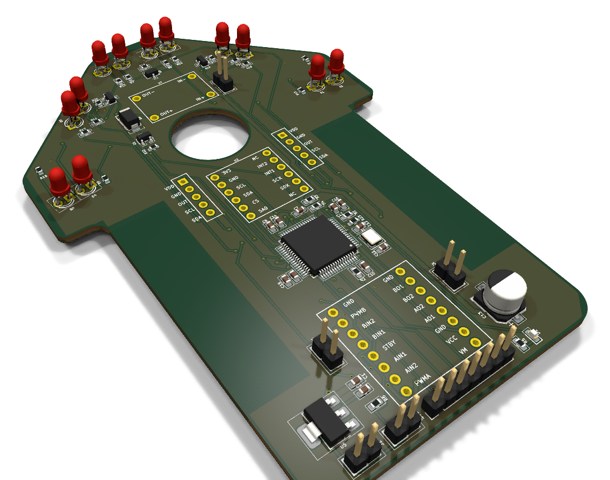
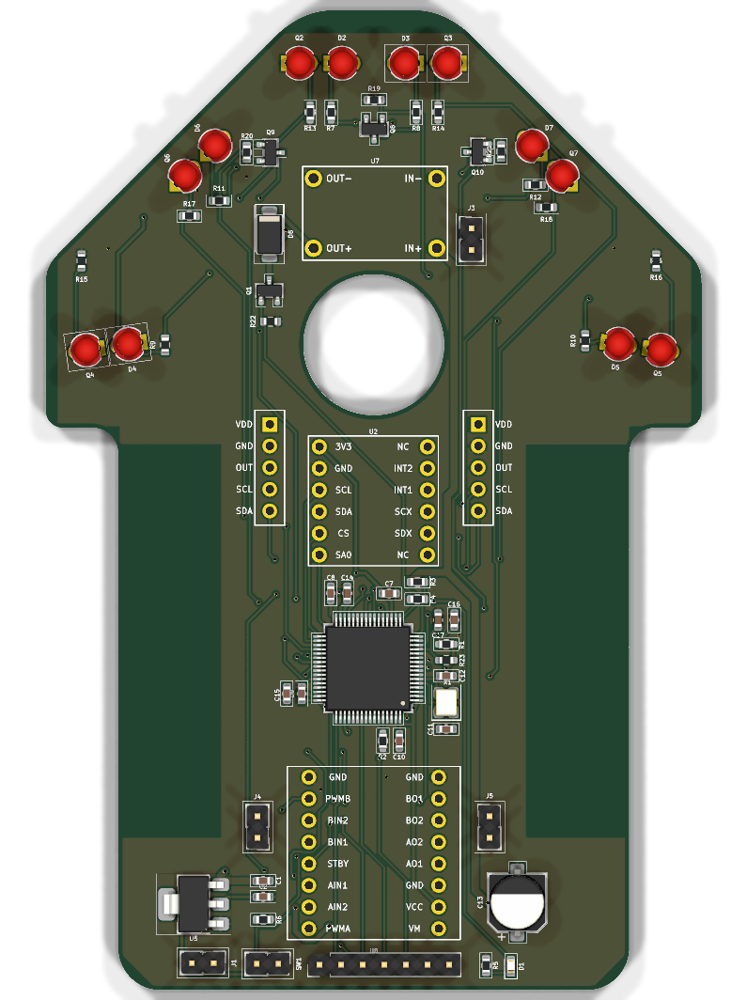
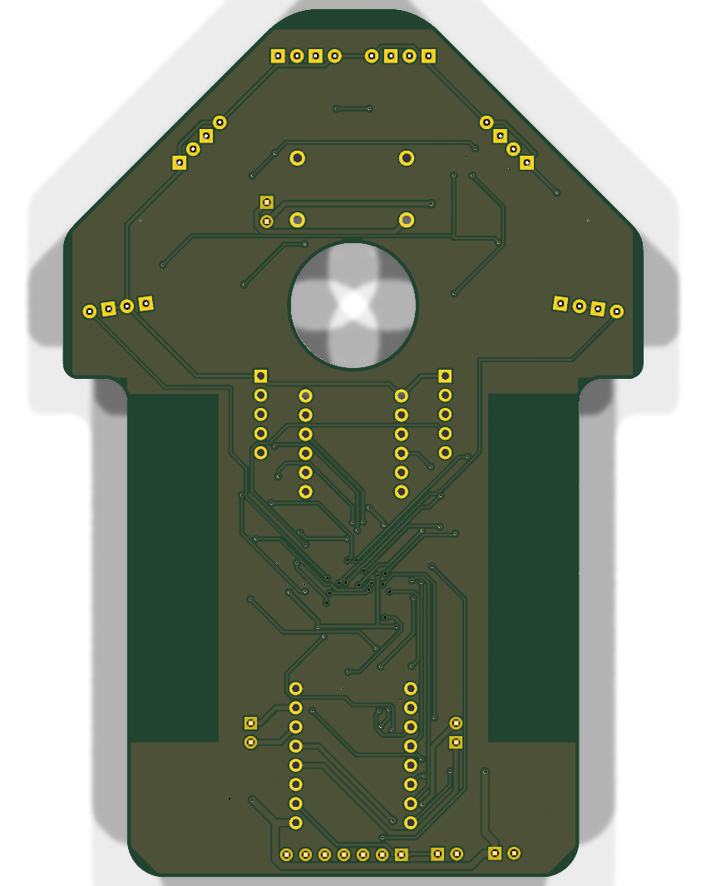
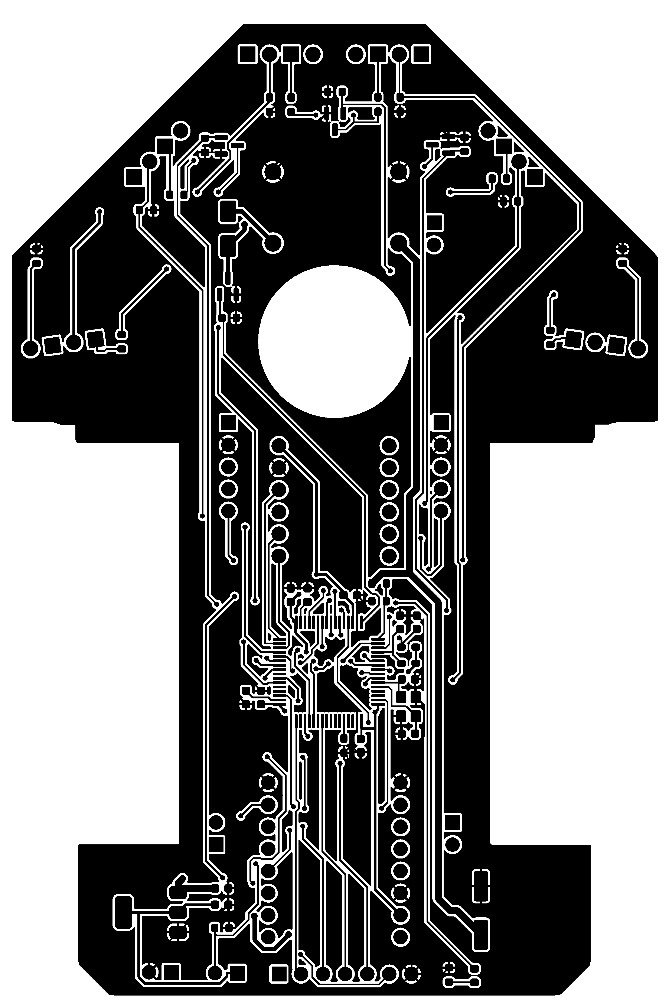
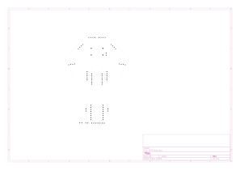

# 🐭 ZAIR - 4WD Vacuum Micromouse

A custom 4WD vacuum micromouse built for the Sri Lanka IIT Micro Maze 3.0 competition (IEEE 16×16).

The PCB also serves as the robot's structural chassis, with cutouts for the drive wheels and a central aperture for a 1020 coreless motor suction fan.

  

---

## 📸 PCB

|                  Top (Components)                  |                        Bottom                         |
| :------------------------------------------------: | :---------------------------------------------------: |
|  |  |

|             Traces / Silkscreen             |                  Outline & Cutouts                  |
| :-----------------------------------------: | :-------------------------------------------------: |
|  |  |

---

## ⚡ Hardware & Components

- **MCU:** STM32F405RGT6 (ARM Cortex-M4 @ 168MHz)
- **Drive Motors:** 2× Coreless 1718 motors
- **Motor Driver:** TB6612FNG breakout (red module)
- **Vacuum Fan:** Coreless 1020 motor switched by an AO3400 N-MOSFET + SS14 flyback diode
- **IMU:** LSM6DSV breakout (SPI2)
- **Encoders:** 2× MT6701 magnetic encoders (vertical 90° mounts, ABZ quadrature mode to TIM2/TIM3)
- **Sensors:** 4 active IR pairs (TEFT4300 phototransistors + SFH4545 850nm emitters, pulsed via AO3400 FETs)
- **Power:**
  - 2S LiPo (7.4V nominal)
  - MP2307 Mini360 buck converter stepped down to 3.5V for the vacuum motor
  - AMS1117-3.3 for 3.3V logic
- **Programming / Debug:** 7-pin header for SWD (`SWDIO`, `SWDCK`, `SWO`) and USART1 (`TX`, `RX`)

---

## 🛠️ PCB Specs & Files

Designed in KiCad.

- **Layers:** 2-layer FR4
- **Dimensions:** ~80mm × 115mm (1.6mm thickness, 1oz copper)
- **Silkscreen:** White

### Files

- **KiCad Project:** `hardware/schematic/ZAIR/`
- **Schematic PDF:** [`hardware/schematic/ZAIR/ZAIR_Schematic.pdf`](hardware/schematic/ZAIR/ZAIR_Schematic.pdf)
- **Gerbers:** [`hardware/schematic/ZAIR/gerbers/`](hardware/schematic/ZAIR/gerbers/)
- **BOM:** [`hardware/schematic/ZAIR/ZAIR.csv`](hardware/schematic/ZAIR/ZAIR.csv)
